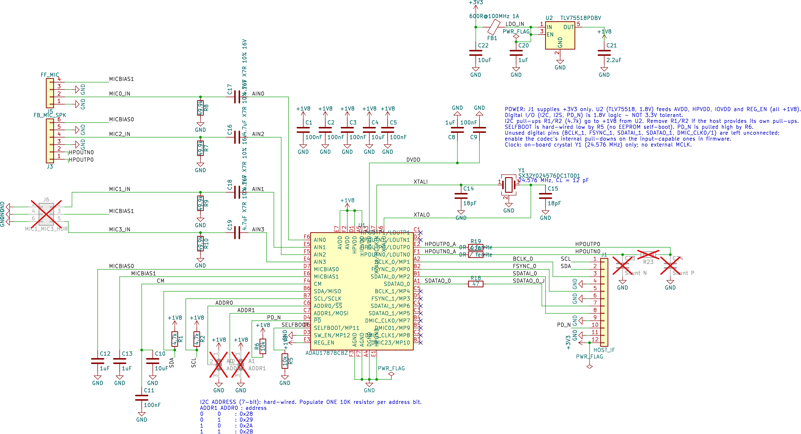
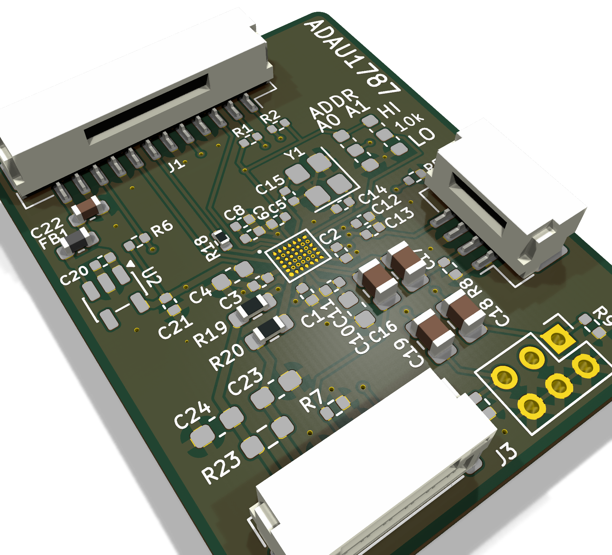

# ADAU1787 Breakout

Compact breakout for the **Analog Devices ADAU1787BCBZ** (WLCSP-42) codec / ANC DSP. Intended for Tranquilify ear-cup prototyping and the first product batch: one board per ear, driven by a **3.3 V power / 1.8 V logic** host (target: ESP32-P4).





## Role in the system

| Ear path | Mic board | ADAU connector | Notes |
|----------|-----------|----------------|--------|
| Feedforward (FF) | `CMM-2718AB-breakout` (11.5×13.5 mm) | **J5** | Outer / ambient mic |
| Feedback (FB) | `CMM-2718AB-micro-breakout` (4.8×6 mm) | **J3** | In-ear mic + speaker on same cable |
| Optional extra mics | header wiring | **J6** | MIC1 / MIC3; leave unpopulated if unused |
| Host | ESP32-P4 (or equivalent) | **J1** | I2C + I2S + PD_N + 3.3 V |

Typical cable into an earbud (see `Earbud Design Notes.md`): driver pair, FB mic OUT/GND, FB mic BIAS/GND — the micro breakout and speaker sit in the bud; the FF mic breakout is the larger board.

## Codec (U1)

| Item | Value |
|------|--------|
| Part | ADAU1787BCBZ |
| Package | WLCSP-42, 0.35 mm pitch (`lib/…/WLCSP-42_…`) |
| Analog / HP / IO / REG_EN | **+1.8 V** from on-board LDO |
| Host supply into board | **+3.3 V** only (on J1) |
| Digital I/O | **1.8 V logic — not 3.3 V tolerant** |
| Clock | On-board 24.576 MHz crystal (no external MCLK) |

Datasheets (repo): `../datasheets/ADAU1787_datasheet_RevA.pdf`, `../datasheets/EVAL-ADAU1787Z-UG-1532.pdf`

## Power

```
J1 +3V3 ── FB1 ── LDO_IN ── U2 TLV75518 ── +1V8
                              │
                    C20 (1µF), C22 (10µF) on input side
                    C21 (2.2µF) + local 100nF / 10µF on +1V8
```

- **U2** (`TLV75518PDBV`, SOT-23-5) generates +1.8 V for AVDD, HPVDD, IOVDD, and REG_EN.
- **FB1**: 600 Ω @ 100 MHz / 1 A class ferrite on the 3.3 V → LDO input path.
- I2C pull-ups **R1 / R2** (4.7 kΩ) are to **+1.8 V**. Remove them if the host already provides 1.8 V pull-ups.
- **SELFBOOT** is held low by R5 (10 kΩ) — no EEPROM self-boot.
- **PD_N** is pulled high by R6 (10 kΩ); host may drive it low to power down.

## I2C address straps (per ear)

Hard-wired with the on-board **ADDR0 / ADDR1** 0603 selectors (`A0` / `A1`). Populate **one** 10 kΩ per bit:

| Strap | LO (0) | HI (1) |
|-------|--------|--------|
| Meaning | 10 kΩ to **GND** | 10 kΩ to **+1.8 V** |

| Ear | ADDR1 | ADDR0 | 7-bit address |
|-----|-------|-------|---------------|
| **Right** | 0 (LO) | 0 (LO) | **0x28** |
| **Left** | 1 (HI) | 0 (LO) | **0x2A** |

Full map on the schematic sheet: 0x28 / 0x29 / 0x2A / 0x2B for ADDR1:ADDR0 = 00 / 01 / 10 / 11.

## Connectors

### J1 — HOST_IF (JST GH 12-pin)

`JST_GH_SM12B-GHS-TB`, 1.25 mm pitch, horizontal.

| Pin | Net | Function |
|-----|-----|----------|
| 1 | SCL | I2C clock (1.8 V) |
| 2 | SDA | I2C data (1.8 V) |
| 3 | BCLK_0 | I2S bit clock |
| 4 | GND | |
| 5 | FSYNC_0 | I2S frame sync / LRCLK |
| 6 | GND | |
| 7 | SDATAO_0_J | I2S data out (via R18 47 Ω) |
| 8 | SDATAI_0 | I2S data in |
| 9 | GND | |
| 10 | PD_N | Active-low power-down |
| 11 | GND | |
| 12 | +3V3 | Board supply |

### J3 — FB_MIC_SPK (feedback mic + in-ear speaker)

`JST_GH_SM06B-GHS-TB`, 6-pin. Feedback (in-ear) mic on the **micro** CMM breakout, plus headphone / receiver drive.

| Pin | Net | Function |
|-----|-----|----------|
| 1 | HPOUTP0 | Speaker / HP positive (after optional R19) |
| 2 | HPOUTN0 | Speaker / HP negative (after optional R20) |
| 3 | GND | |
| 4 | MIC2_IN | Feedback mic OUT (AC-coupled on board → AIN2) |
| 5 | GND | |
| 6 | MICBIAS0 | Bias for feedback mic |

### J5 — FF_MIC (feedforward mic)

`JST_GH_SM04B-GHS-TB`, 4-pin. Feedforward mic on the **regular** CMM breakout.

| Pin | Net | Function |
|-----|-----|----------|
| 1 | GND | |
| 2 | MIC0_IN | FF mic OUT (AC-coupled on board → AIN0) |
| 3 | GND | |
| 4 | MICBIAS1 | Bias for FF mic |

### J6 — MIC1_MIC3_HDR (optional)

2×3 pin header, 2.00 mm. Extra analog mic inputs; leave unpopulated when unused.

| Pin | Net |
|-----|-----|
| 1 | MIC1_IN |
| 2 | GND |
| 3 | MICBIAS1 |
| 4 | GND |
| 5 | MIC3_IN |
| 6 | GND |

## Analog mic inputs

Each used AIN path has:

- Series **4.7 µF X7R 10% 16V** (0805) AC-coupling: C17→AIN0, C16→AIN2, C18→AIN1, C19→AIN3
- **49.9 kΩ** to GND on the mic side of the coupling cap (R8 / R7 / R9 / R10)

MICBIAS0 / MICBIAS1 each have **1 µF** local bypass (C12 / C13). CM filter: C10 10 µF + C11 100 nF.

## Headphone / speaker path (HPOUT0)

Default path is through **R19 / R20** (`0R / ferrite` placeholders) to HPOUTP0 / HPOUTN0 on J3.

Optional tuning (populate only if needed):

| Ref | Value field | Role |
|-----|-------------|------|
| R19, R20 | `0R / ferrite` | Series 0 Ω jumpers or ferrites on HP outs |
| C23, C24 | `Shunt N` / `Shunt P` | Optional shunts to GND |
| R23 | `P-N` | Optional P–N damping / load between HP outs |

Treat these as **DNP by default** unless a speaker loadout needs them.

## Clock

| Ref | Part / value | Notes |
|-----|--------------|--------|
| Y1 | SX32Y024576DC1T001 | 24.576 MHz, CL = 12 pF |
| C14, C15 | 18 pF | Load caps |

## Digital / unused pins

Unused digital pins (second I2S port, DMIC clocks/data, etc.) are left unconnected. Enable the codec’s **internal pull-downs** in firmware on input-capable unused pins (schematic note calls out BCLK_1, FSYNC_1, SDATAI_1, SDATAO_1, DMIC_CLK0/1 and related).

SDATAO_0 goes through **R18** (47 Ω) to the host connector.

## Mechanical / PCB

| Item | Value |
|------|--------|
| Board size | **~27.3 × 34.5 mm** |
| Layers | **4** |
| Fab target | JLCPCB-class; via-in-pad allowed for U1 WLCSP |
| Libraries | Project-local `lib/ADAU1787-breakout.*` |

## Firmware / host checklist

1. Supply **3.3 V** on J1 pin 12; keep digital lines at **1.8 V**.
2. Strap addresses: right **0x28**, left **0x2A** (see table above).
3. Bring up I2C, release PD_N, configure PLL from the 24.576 MHz crystal.
4. Enable internal pull-downs on unused digital inputs.
5. Route FF mic → J5, FB mic + speaker → J3; bias rails must stay within the mic’s 1.5–3.6 V VDD range (codec MICBIAS settings).

## Project files

| Path | Role |
|------|------|
| `ADAU1787-breakout.kicad_pro` | KiCad project |
| `ADAU1787-breakout.kicad_sch` | Schematic |
| `ADAU1787-breakout.kicad_pcb` | PCB |
| `docs/schematic.png` | Schematic render |
| `docs/board.png` / `docs/board-3d.png` | Board renders |
| `lib/ADAU1787-breakout.kicad_sym` | Codec symbol |
| `lib/ADAU1787-breakout.pretty/` | WLCSP + selector footprints |

## Related boards

- [`CMM-2718AB-breakout`](../CMM-2718AB-breakout/README.md) — FF mic (this board’s J5)
- `CMM-2718AB-micro-breakout` — FB mic in the earbud (this board’s J3); see that folder’s `ORDERING.md`
