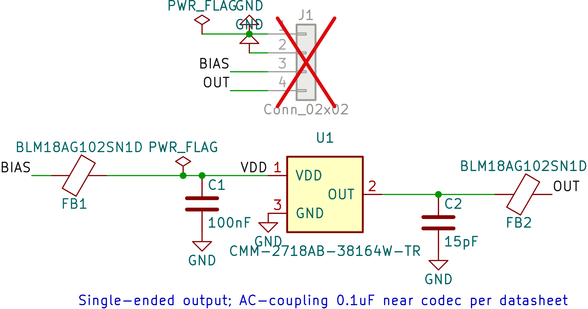
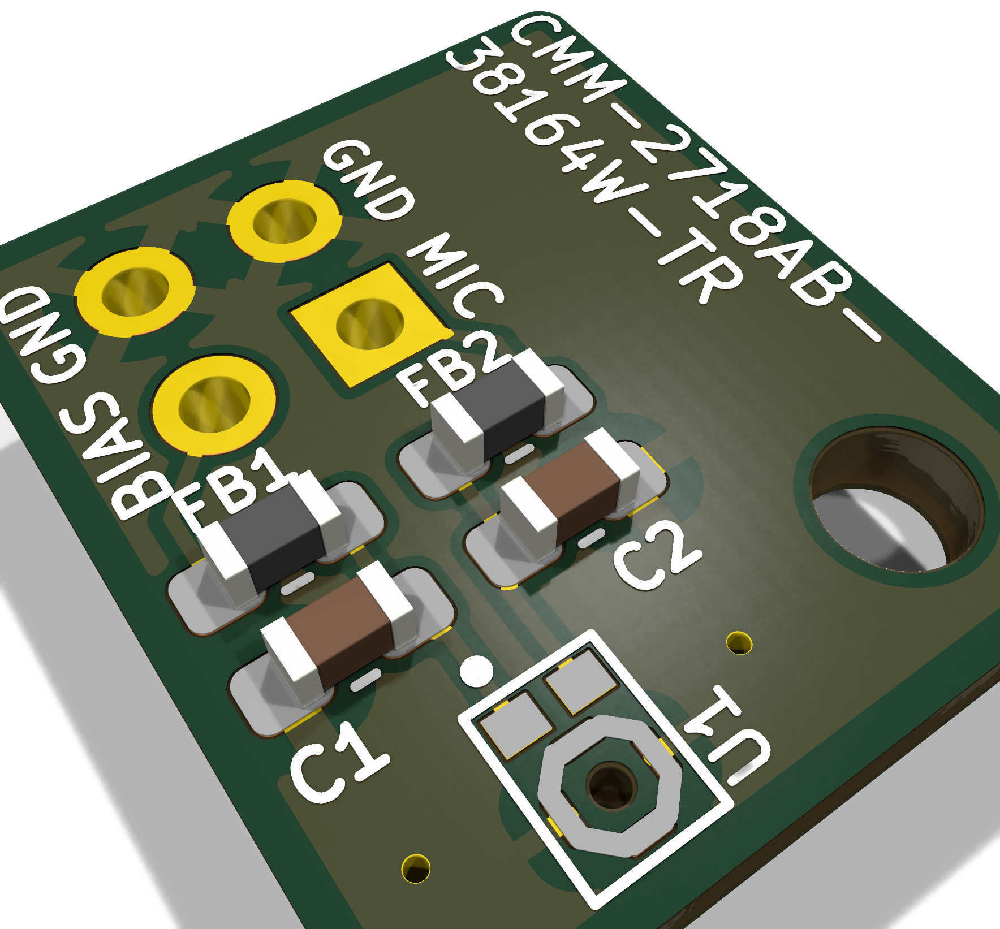

# CMM-2718AB Breakout

Single-ended analog MEMS microphone breakout for the **Same Sky CMM-2718AB-38164W-TR** (bottom-port). Hand-solder friendly prototype board (0603 passives, 2.54 mm header).





## Purpose

Through-hole breakout for prototyping / wiring into a host (e.g. ADAU1787 or other codec). On-board parts are only the mic-local filter/bypass recommended near the microphone; AC-coupling and bias/load decisions for the codec stay on the host board.

In the Tranquilify ear-cup setup this board is the **feedforward (FF)** mic path into the ADAU1787 breakout (`J5`).

## Microphone (U1)

| Item | Value |
|------|--------|
| Part | CMM-2718AB-38164W-TR |
| Type | Analog, omnidirectional, bottom port |
| Package | 2.75 × 1.85 × 0.90 mm |
| VDD | **1.5 – 3.6 V** (datasheet specs typically at 1.8 V) |
| Current | ~175 µA typ |
| Sensitivity | −38 dB typ (1 V/Pa, 1 kHz) |
| Output Z | ~170 Ω @ 1 kHz |
| DC on OUT | ~0.75 V typ (must be AC-coupled at the receiver) |
| Operating temp | −20 to +70 °C |

### Mic pin map (device)

| Pad | Function |
|-----|----------|
| 1 | VDD |
| 2 | OUT |
| 3 | GND (segmented land on this board’s custom footprint) |

Datasheet: [Same Sky CMM-2718AB-38164W-TR](https://www.sameskydevices.com/product/resource/cmm-2718ab-38164w-tr.pdf)  
Local copy: `../datasheets/cmm_2718ab_38164w_tr.pdf`

## Header pinout (J1)

2×2 vertical pin header (`PinHeader_2x02_P2.54mm_Vertical`).

Physical orientation (board top view, header toward the top edge, mic toward the bottom):

```
  GND (1)    GND (2)     ← top (away from mic)
  BIAS (3)   MIC (4)     ← bottom (toward mic / circuit)
```

| Pin | Net | Silkscreen | Notes |
|-----|-----|------------|--------|
| 1 | GND | GND | |
| 2 | GND | GND | |
| 3 | BIAS | BIAS | Mic supply / bias input (feeds FB1 → VDD) |
| 4 | OUT | **MIC** | Analog mic output (DC-biased); silk says MIC |

Pad 4 is the rectangular pad. Silkscreen labels match this map.

## Circuit

```
BIAS ── FB1 ──┬── C1 (100nF) ── GND
              └── U1 VDD

U1 OUT ──┬── C2 (15pF) ── GND
         └── FB2 ── J1 MIC (OUT)

U1 GND / C1 GND / C2 GND / J1 GND ── shared GND pour
```

- **FB1**: series ferrite on the bias rail (RF / supply noise isolation).
- **FB2**: series ferrite on the mic output (same part as FB1).
- **C1**: local VDD bypass at the mic (datasheet: place near MIC).
- **C2**: small RF shunt on OUT near the mic (before FB2).
- **No on-board AC-coupling series capacitor** — add that at the codec/input stage (ADAU1787 breakout already has 4.7 µF on each AIN).

## BOM / part requirements

| Ref | Value | Package | Requirements / notes |
|-----|--------|---------|----------------------|
| U1 | CMM-2718AB-38164W-TR | Custom | Do **not** feed 5 V. Bottom acoustic port must stay open. |
| C1 | 100 nF | 0603 hand-solder | **X5R or X7R** ceramic (X7R preferred). **≥6.3 V**; 10 V / 16 V typical. Avoid Y5V/Z5U. |
| C2 | 15 pF | 0603 hand-solder | **C0G/NP0** preferred for RF stability; X7R OK if needed. |
| FB1 | BLM15AG102SN1D (or equiv.) | 0603 hand-solder | ~600–1000 Ω @ 100 MHz. Mic current is tiny; no high-current bead needed. |
| FB2 | BLM15AG102SN1D (or equiv.) | 0603 hand-solder | Same as FB1; series on OUT. |
| J1 | 2×2 TH pin header, 2.54 mm | — | Standard vertical header. |
| H1 | MountingHole 2.2 mm (M2) | NPTH | Use nylon screw or insulated washer if the head could short the GND pour. |

### Suggested default line items

- C1: 100 nF, X7R, 10 V, 0603  
- C2: 15 pF, C0G, 50 V, 0603  
- FB1 / FB2: Murata BLM15AG102SN1D (or equivalent 1 kΩ @ 100 MHz, 0603)

## Mechanical / PCB

| Item | Value |
|------|--------|
| Board size | **11.5 × 13.5 mm** (rounded corners) |
| Layers | 2 (F.Cu / B.Cu) |
| GND | Full-board pours on both layers + stitch vias |
| Mounting | H1 = M2 clearance hole (2.2 mm), mic side |
| Libraries | Project-local: `libraries/CMM-2718AB-breakout.*` |

### Custom footprint notes

- Footprint ID: `CMM-2718AB-breakout:CMM-2718AB-38164W-TR`
- Includes 0.5 mm acoustic **NPTH** at port center.
- GND is four pad-3 segments around the port (datasheet-style land).
- DRC may report **~0.16 mm pad clearance** between VDD/OUT and nearby GND segments vs a 0.20 mm board rule. That matches the tight MEMS land pattern; most fabs that allow 0.15 mm are fine. Do not “fix” by shrinking signal pads without checking the datasheet land recommendation.

## Layout / design intent

- Keep **C1 and C2 next to the mic**; keep FB1 on the BIAS→VDD path before the local bypass; keep FB2 in series on OUT toward the header.
- Prefer **short OUT**; keep BIAS/VDD and OUT on opposite sides where possible.
- Solid GND pour under/around the mic return matters more than exotic routing on this breakout.
- Leave copper/paste/silk clear of the acoustic hole.

## Assembly & handling (mic)

From the Same Sky datasheet:

1. Max **3 reflow** cycles; peak profile per datasheet (~260 °C).
2. **Not washable** after reflow; avoid solvents / brushing.
3. No ultrasonic cleaning or processing.
4. Do not blow debris into the port, insert objects, over-pressure (>30 psi), or pull vacuum on the port.
5. MSL Class 1.

## How to use with a host / codec

1. Supply **1.5–3.6 V** on **BIAS** (same net family as mic VDD after FB1). On the ADAU1787 breakout this comes from a MICBIAS rail.
2. Tie host GND to both GND pins (or either; they are common).
3. Take **MIC** into the codec/preamp through a **series AC-coupling capacitor** on the host.
4. Ensure the host input can tolerate / ignore the mic’s ~0.75 V DC bias before the coupling cap.
5. Mount so the **bottom port** has a clear path to free air (or the intended acoustic cavity); do not cover the board hole.

## Project files

| Path | Role |
|------|------|
| `CMM-2718AB-breakout.kicad_pro` | KiCad project |
| `CMM-2718AB-breakout.kicad_sch` | Schematic |
| `CMM-2718AB-breakout.kicad_pcb` | PCB |
| `docs/schematic.png` | Schematic render |
| `docs/board.png` / `docs/board-3d.png` | Board renders |
| `libraries/CMM-2718AB-breakout.kicad_sym` | Custom mic symbol |
| `libraries/CMM-2718AB-breakout.pretty/` | Custom mic footprint |
| `production/` | Exported fab outputs (if regenerated) |

## Known / accepted issues

- Mic footprint pad-to-pad clearance vs 0.2 mm rule (see above).
- Stock `MountingHole_2.2mm_M2` courtyard is large and may overlap nearby part courtyards in DRC even when copper/mechanics are fine — verify screw-head clearance to passives by eye.
- Prefer a single pair of GND zones (F.Cu + B.Cu) sized to the current outline; delete duplicate/old zones after outline resizes to avoid isolated-fill warnings.

## Revision notes (design history)

- Header pinout: **GND-on-top / BIAS+MIC-on-bottom**.
- Board outline grown to **11.5 × 13.5 mm** for mounting-hole and hand-solder clearance.
- Passives enlarged to **0603 hand-solder** footprints for this prototype board.
- On-board circuit: FB1 + FB2 + 100 nF + 15 pF.
